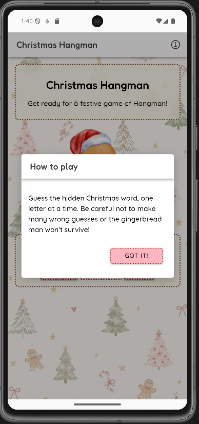
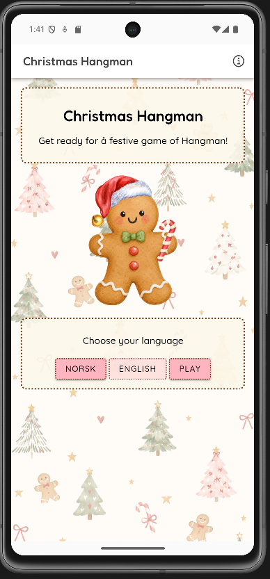
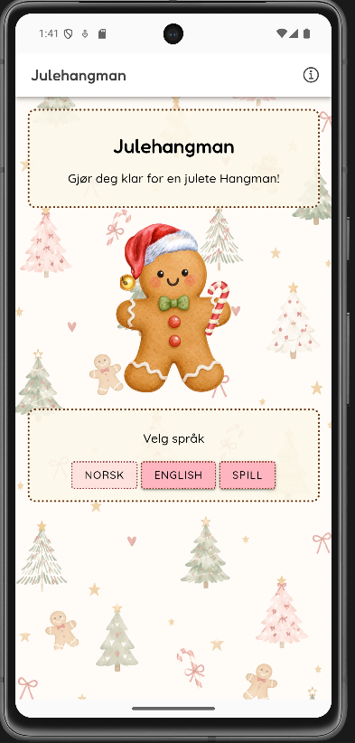
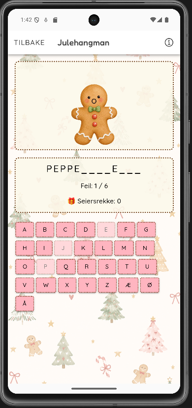
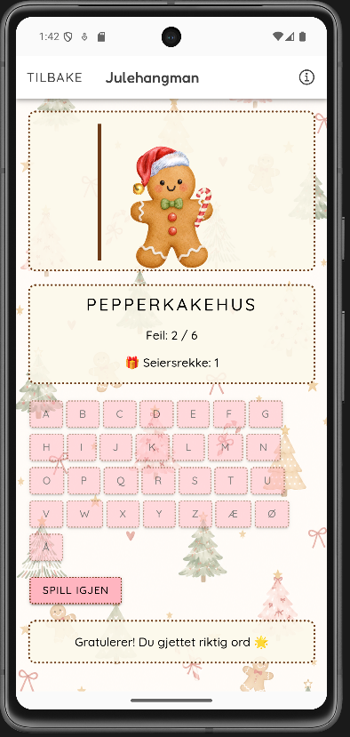
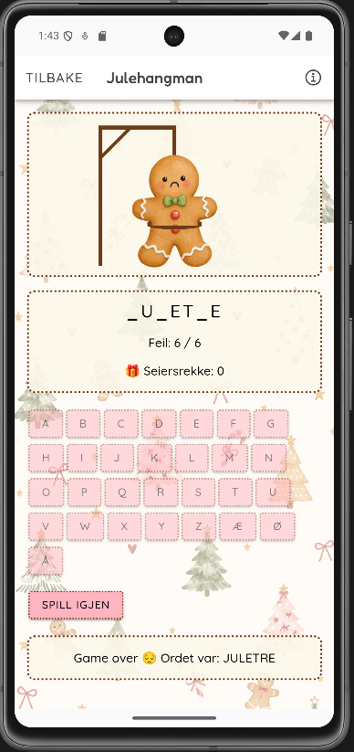
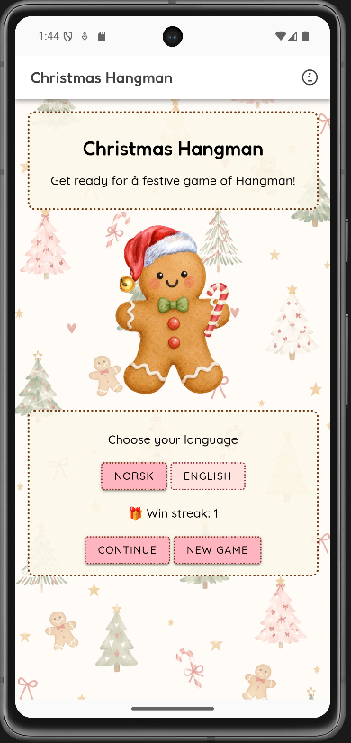

# IDATT2506-Final-Project
Cross-platform Christmas-themed hangman game with Norwegian and English language support. The game is developed using Ionic React, TypeScript, HTML/CSS and Capacitor. 

## Features
* Christmas-themed user interface
* Instructions displayed when opening the app for the first time, and accessible during gameplay
* Support for Norwegian and English
* Separate word lists for each language
* Interactive keyboard for guessing letters
* Win streak tracking

## Screenshots of the game









---

## Project setup
> Run the following commands from the christmas-hangman directory.

### Prerequisites
* Node.js and npm
* Ionic CLI
* Android Studio with an Android emulator

### How to run
1. Navigate to the christmas-hangman directory
2. Install dependencies:
```sh
npm install
```
3. Build the application:
```sh
ionic build
```
4. Synchronize the Android project:
```sh
npx cap sync android
```
5. Open the project in Android Studio:
```sh
npx cap open android
```
6. Select an Android emulator and click **Run**

## Android emulator
The following emulator was used for testing:
* Device: Google Pixel 7
* Android version: Android 15.0 (API 35)
* Architecture: x86_64

The application was also manually tested on a physical Google Pixel 9 device.

---

## Running in a web browser
The application can also be tested in a web browser using Ionic
1. Navigate to the christmas-hangman directory.
2. Install dependencies:
```sh
npm install
```
3. Start the development server:
```sh
ionic serve
```

The application will open in a web browser.

